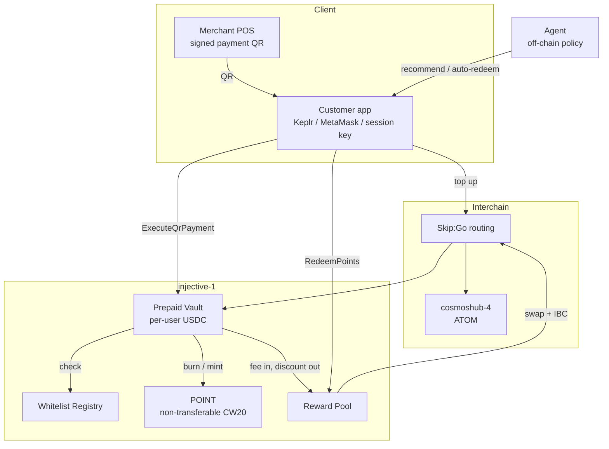

# agentic-qr-payment

Demo of a non-custodial prepaid QR payment and point reward program on Injective.

Users deposit USDC into their own Prepaid Vault, pay whitelisted cafes and restaurants by QR without a wallet popup, earn soulbound POINT, and redeem POINT for ATOM, USDC.inj or INJ. An AI agent recommends or runs the redemption, and ATOM always returns more value per point than USDC.inj.

This repository is a working simulation. A Go server models the contracts in memory and serves a web UI. Skip:Go routes, prices and transaction hashes are simulated; nothing is sent on-chain.

## Contents

- [Goals](#goals)
- [Architecture](#architecture)
- [Contracts](#contracts)
- [Flows](#flows)
- [POINT economics](#point-economics)
- [Fee structure](#fee-structure)
- [Agent](#agent)
- [Skip:Go](#skipgo)
- [Mintscan](#mintscan)
- [Wallets](#wallets)
- [Status](#status)
- [Run](#run)
- [Layout](#layout)
- [API](#api)
- [Data](#data)
- [Editing](#editing)

## Goals

| Goal | How |
| --- | --- |
| The platform never holds user funds | Each user's USDC sits in a Prepaid Vault that only the owner, or a capped session key the owner registered, can move |
| Paying at a counter feels like a card tap | A session key with per-payment and daily limits signs QR payments; gas is paid through `x/feegrant` |
| Only approved merchants can be paid | The Whitelist Registry is checked inside the payment transaction |
| Rewards bring users back to the same merchants | POINT is earned on payment and spent as a discount at whitelisted merchants |
| Rewards flow into the Cosmos ecosystem | POINT redeems to ATOM, INJ or USDC.inj; ATOM gets the highest value per point |
| User principal and reward funding stay separate | Redemptions and POINT discounts are paid from a Reward Pool funded by merchant fees and sponsors, never from user Vaults |

## Architecture



| Component | Role | In this repo |
| --- | --- | --- |
| Prepaid Vault | Holds each user's USDC; executes payments, refunds and withdrawals | `internal/engine/payment.go`, `vault.go` |
| Whitelist Registry | Merchant ID, status, settlement address, fee and earn rates | `internal/engine/admin.go`, `engine.go` |
| POINT | Non-transferable reward token; only minted on payment and burned on discount or redemption | `User.Points` in `internal/engine` |
| Reward Pool | Funds POINT discounts and redemptions; receives merchant fees and sponsor budget | `internal/engine/rewards.go`, `admin.go` |
| Session key | Key registered on the Vault with per-payment and daily limits, used for QR payments | `Session` in `internal/engine/types.go` |
| Agent | Reads the user's policy after each payment and suggests or runs a redemption | `runAgent` in `internal/engine/rewards.go` |
| Web UI | Customer app, merchant POS and operator view | `web/index.html` |

## Contracts

### Prepaid Vault

- One balance per user address. Only two signers can move funds:
  - The owner's wallet: deposit, withdraw, register or revoke a session key.
  - The owner's session key: `ExecuteQrPayment` only, within its limits.
- Withdrawal is owner-signed and is not affected by session limits or a Reward Pool pause.
- Session limits are enforced inside the contract, because `x/authz` cannot cap an amount passed as a contract argument and the contract cannot tell an authz call from a direct call. `x/feegrant` (`AllowedMsgAllowance` for `MsgExecuteContract` plus `PeriodicAllowance`) pays gas for session-key transactions.

| Message | Signer | Effect |
| --- | --- | --- |
| `DepositUsdc` | Owner, or Skip:Go post-route action | Adds USDC to the owner's Vault |
| `Withdraw` | Owner | Sends Vault USDC back to the owner |
| `RegisterSession` / `RevokeSession` | Owner | Sets or removes the session key and its limits |
| `ExecuteQrPayment` | Session key or owner | Atomic payment, see [Payment](#payment) |
| `RefundPayment` | Merchant | Reverses a payment within the refund window |

### Whitelist Registry

| Field | Type | Example |
| --- | --- | --- |
| `merchant_id` | string | `MRC_CAFE_001` |
| `name` | string | Seongsu Roastery Cafe |
| `category` | enum `CAFE`, `RESTAURANT`, `OTHER` | `CAFE` |
| `status` | enum `ACTIVE`, `SUSPENDED` | `ACTIVE` |
| `settlement_addr` | inj1 address | `inj1abc...xyz` |
| `fee_bps` | u16 | `150` (1.5%) |
| `point_earn_bps` | u16 | `300` (3.0%) |
| `pubkey` | ed25519 public key (hex) | `5e916eaa...` |

Only `ACTIVE` merchants can be paid. `pubkey` verifies the merchant's QR signatures. Status changes are signed by the registry admin multisig.

### POINT

- 1 POINT = 0.01 USDC.
- Transfer and send are disabled. The only state changes are:
  - Mint on a successful whitelisted payment.
  - Burn as a payment discount.
  - Burn on redemption from the Reward Pool.

### Reward Pool

- Inflows: merchant fees, sponsor and marketing budget.
- Outflows: POINT discounts paid to merchants, redemptions including boost.
- Controls: per-user daily redeem cap, boost per asset, pause. A pause stops POINT discounts and redemptions only; user Vaults keep working.
- Boost rule: a boost setting is rejected unless 1,000 POINT redeemed to ATOM is worth more than 1,000 POINT redeemed to USDC.inj after route cost.

## Flows

### Top up

1. The client asks Skip:Go for a route from the source chain's USDC to injective-1 USDC.
2. The user's wallet signs on the source chain.
3. Skip:Go delivers USDC and calls `Vault.DepositUsdc` for the user as the post-route action.

From an Injective wallet the deposit is direct, with no route.

### Payment

The merchant POS shows a signed QR (MPM v2.0):

```json
{
  "qr_version": "2.0",
  "merchant_id": "MRC_CAFE_001",
  "order_id": "ORD_20261123_0042",
  "amount_usdc": "12.50",
  "currency": "USDC.inj",
  "expires_at": 1795395000,
  "merchant_sig": "0x..."
}
```

QR authentication: the merchant POS signs the canonical string below with its ed25519 private key. The app sends the whole scanned payload, and the contract verifies `merchant_sig` with the `pubkey` registered for `merchant_id`. Changing any field, such as the amount, breaks the signature.

```
qr_version|merchant_id|order_id|amount_usdc|currency|expires_at
```

Before paying, the app shows four checks from `/api/qr/verify`: store signature, approved store, not expired, order not paid yet.

`ExecuteQrPayment` runs these checks and changes in one transaction. If any check fails, nothing moves.

1. `merchant_sig` verifies against the registered `pubkey`.
2. Merchant is `ACTIVE` in the registry.
3. QR has not expired (120 seconds).
4. `order_id` has not been paid.
5. Split the amount:

   ```
   A        = order amount
   P_used   = min(user POINT, floor(A / 0.01))      if "use POINT first" is on
   A_point  = P_used * 0.01
   A_usdc   = A - A_point
   ```

6. Session limits: `A_usdc <= per_payment_limit` and `spent_today + A_usdc <= daily_limit`.
7. Vault balance `>= A_usdc`, and Reward Pool balance `>= A_point`.
8. Move funds and POINT:

   ```
   fee       = A_usdc * fee_bps / 10000
   P_earned  = floor(A * point_earn_bps / 10000 / 0.01)

   Vault           -A_usdc
   POINT           -P_used (burn), +P_earned (mint)
   Merchant        +(A_usdc - fee) + A_point
   Reward Pool     +fee - A_point
   ```

The merchant always receives the full order amount minus the fee; the POINT portion is paid by the Reward Pool.

Rejection codes: `ERR_MERCHANT_NOT_WHITELISTED`, `ERR_QR_EXPIRED`, `ERR_ORDER_ALREADY_PAID`, `ERR_BAD_SIGNATURE`, `ERR_SESSION_TX_LIMIT`, `ERR_SESSION_DAILY_LIMIT`, `ERR_INSUFFICIENT_VAULT`, `ERR_POOL_INSUFFICIENT`.

### Refund

The merchant signs `RefundPayment` within 10 minutes of the payment.

```
POINT       +P_used (re-mint), -min(P_earned, current POINT) (burn)
Vault       +A_usdc - (POINT earned but already redeemed) * 0.01
Merchant    -(A - fee)
Reward Pool +A_point - fee + (already redeemed POINT) * 0.01
```

### Redeem

1. The user or the agent burns POINT through `RewardPool.RedeemPoints`.
2. The pool pays `value + boost`, where `value = POINT * 0.01`.
3. The payout is routed by target:
   - ATOM: Skip:Go swaps USDC to `uatom` and sends it over IBC to the user's `cosmos1` address.
   - INJ: Skip:Go swaps USDC to INJ on injective-1.
   - USDC.inj: credited to the user's Vault, and the next payment earns +1% POINT.
4. Checks: pool not paused, per-user daily redeem cap, pool balance.

### Withdraw

The owner signs `Vault.Withdraw` to send USDC back to their own address. No limit or pause applies.

## POINT economics

| Parameter | Demo value |
| --- | --- |
| POINT value | 1 POINT = 0.01 USDC |
| Earn rate | `point_earn_bps` of the order amount: cafes 3.0%, restaurant 5.0% |
| Redeem boost | ATOM +10%, INJ +5%, USDC.inj 0% (+1% earn on next payment) |
| Route cost (sample) | ATOM 0.6%, INJ 0.3%, USDC.inj 0% |
| Daily redeem cap | $50 per user |

Value of 1,000 POINT ($10.00) with demo settings:

| Target | Boost | Route cost | Net value | Amount at sample price |
| --- | --- | --- | --- | --- |
| ATOM ($4.80) | +$1.00 | -$0.066 | $10.934 | 2.2779 ATOM |
| INJ ($9.50) | +$0.50 | -$0.0315 | $10.4685 | 1.1020 INJ |
| USDC.inj | $0 | $0 | $10.00 | 10.00 USDC.inj |

The operator view shows pool coverage: `pool balance / (outstanding POINT * 0.01)`.

## Fee structure

### Fees in the demo

| Fee | Payer | Rate | Goes to |
| --- | --- | --- | --- |
| Merchant fee | Merchant | 1.5% (cafes), 2.0% (restaurant) of `A_usdc` | Reward Pool |
| Top-up route fee (sample) | User | Ethereum 0.4%, Solana 0.2%, Base 0.1%, Injective 0% | Route |
| Redeem route cost (sample) | Reward Pool | ATOM 0.6%, INJ 0.3% | Route |
| Gas | Platform | Per transaction, via feegrant | Validators |

With these settings, a $100 order paid in USDC brings $1.50 into the pool and mints 300 POINT ($3.00) of liability, so the pool needs outside funding.

### Target model

| Item | Rate | Payer | Destination |
| --- | --- | --- | --- |
| Merchant fee | 1.5% of `A_usdc` | Merchant | 0.5% platform revenue, 1.0% Reward Pool |
| POINT earn | 1.0% of `A_usdc` (POINT-paid portion earns nothing) | Reward Pool | User |
| ATOM boost | +10% of redeemed value | Ecosystem sponsor budget | User |
| Routing fee | 0.2-0.3% on top-up and redemption swaps | User | Platform, through Skip:Go affiliate fees |
| POINT expiry | Unused for 12 months | - | Returned to the Reward Pool |

Rules:

- Earn rate never exceeds the pool share of the merchant fee (1.0% <= 1.0%), so normal payments keep the pool solvent.
- Boosts that steer rewards to ATOM are paid by sponsors who benefit from ATOM inflow, not by the platform.
- The platform covers servers and feegrant gas from its 0.5% share and routing fees.

Example, $10 order paid in USDC:

| Line | Amount |
| --- | --- |
| Merchant fee 1.5% | $0.15 |
| Platform revenue 0.5% | $0.05 |
| Reward Pool 1.0% | $0.10 |
| POINT minted (1.0%) | 10 P = $0.10 liability |
| Merchant receives | $9.85 |

Platform break-even: `monthly fixed cost / (0.005 - gas cost per payment / average order)`.

### Merchant value

- Settlement goes to `settlement_addr` in the same transaction as the payment.
- No chargebacks; only the merchant can sign a refund.
- POINT can only be spent at whitelisted merchants, which brings customers back.
- Accepts customers who hold USDC but no local card.

## Agent

Policy per user (off-chain, enforced by on-chain limits):

```json
{
  "user_address": "inj1user987654321",
  "authz_max_per_tx_usdc": "50.00",
  "authz_daily_limit_usdc": "200.00",
  "use_point_first_on_qr": true,
  "auto_redeem_policy": {
    "enabled": true,
    "threshold_points": 500,
    "target_allocation": { "ATOM": 0.5, "USDC_INJ": 0.3, "INJ": 0.2 }
  }
}
```

After each payment:

| POINT balance | Auto-redeem | Agent action |
| --- | --- | --- |
| Below threshold | Any | Shows how many POINT remain to the threshold and the discount available on the next order |
| At or above threshold | Off | Shows a one-click card: convert all POINT to ATOM, with the extra value over USDC.inj |
| At or above threshold | On | Redeems by `target_allocation`; rounding remainder goes to ATOM |

## Skip:Go

[Skip:Go](https://go.skip.build/) provides the cross-chain routes. The demo simulates its calls and labels each screen that uses it.

| Flow | Route | Simulated call |
| --- | --- | --- |
| Top up USDC on Base (8453), Ethereum (1) or Solana (`solana`) | USDC -> injective-1 USDC.inj, then `Vault.DepositUsdc` as the post-route action | `SkipClient.route()`, `SkipClient.executeRoute()` |
| Top up USDC.inj on Injective (default) | Direct deposit, no route | `Vault.DepositUsdc` |
| Redeem POINT to ATOM | injective-1 USDC -> cosmoshub-4 `uatom`, IBC transfer to the user's `cosmos1` address | `RewardPool.RedeemPoints` |
| Redeem POINT to INJ | USDC -> INJ swap on injective-1 | `RewardPool.RedeemPoints` |
| Redeem POINT to USDC.inj | No route, credited to the Vault | `RewardPool.RedeemPoints` |

Route fees and prices come from `routeFeeBps`, `topupChains` and `price` in `internal/engine/types.go`. They are sample values, not live Skip:Go quotes.

## Mintscan

Each simulated contract call (`Vault.*`, `RewardPool.*`, `Registry.*`) gets a 64-character transaction hash. A rejected payment also gets one, as a reverted transaction would. The activity list, payment receipt and on-chain activity log link to:

```
https://www.mintscan.io/injective/tx/<TX_HASH>
```

The hashes are generated locally, so Mintscan shows "not found" until the contracts are deployed and real hashes are returned. Off-chain steps (route quotes, wallet connect, agent policy) have no hash.

## Wallets

| Wallet | Addresses used | Notes |
| --- | --- | --- |
| Keplr | `inj1` from injective-1, `cosmos1` from cosmoshub-4 | ATOM goes to the Keplr `cosmos1` address |
| MetaMask | `0x` address converted to `inj1` (same 20 bytes, bech32) | MetaMask has no `cosmos1` address; ATOM goes to the demo address |

Wallet connect reads addresses only. Balances stay simulated and no signature is requested.

## Status

### Working in the demo

| Area | What works |
| --- | --- |
| Users | Three demo users, each with their own Vault balance, POINT, ATOM, INJ, session, policy and activity |
| Top up | Quote and deposit of USDC.inj on Injective (default, direct) or USDC on Base, Ethereum or Solana (simulated Skip:Go route); Skip:Go-style asset picker |
| Payment | Merchant QR (MPM v2.0) with ed25519 signature, 120 s expiry and one-time `order_id`; preview before paying; POINT-first discount; fee to the Reward Pool; POINT minted in the same transaction |
| QR authentication | Four checks shown in the app; a forged QR (amount changed) fails the signature check and is rejected |
| Rejections | Forged QR, suspended merchant, expired QR, reused order, session per-payment and daily limits, insufficient Vault balance, insufficient Reward Pool |
| Screens | Customer, merchant (POS and store dashboard with refund) and overview (platform totals) on one page |
| Refund | Merchant-signed cancel within 10 minutes; POINT used is returned, POINT earned is removed, already-redeemed POINT is deducted from the refund |
| Withdraw | Owner-signed, not affected by session limits or a pool pause |
| Session key | Grant, revoke, per-payment and daily limits; daily counters reset when the date changes |
| Redeem | ATOM, INJ or USDC.inj with boost, daily cap and pool checks; ATOM marked as best value |
| ATOM preference | ATOM +10%, INJ +5%, USDC.inj 0% with +1% earn on the next payment; boost changes rejected unless ATOM beats USDC.inj after route cost |
| Agent | After each payment: progress to threshold, one-click ATOM card, or auto-redeem by allocation |
| Operator | Reward Pool balance, coverage, inflow and outflow totals, daily redeem cap, budget top-up, pause, boost settings, merchant approve/suspend |
| Wallets | Keplr (`inj1` and `cosmos1`) and MetaMask (`0x` converted to `inj1`), address only |
| Links | Skip:Go attribution on routed screens; Mintscan link for every simulated contract transaction |

### Not implemented

| Area | Current state |
| --- | --- |
| Contracts | Go in-memory simulation; no CosmWasm contracts deployed |
| Skip:Go | Calls are simulated; no live routes, quotes or execution |
| Prices | Fixed sample prices (ATOM $4.80, INJ $9.50) |
| Transaction hashes | Generated locally; Mintscan shows "not found" |
| Wallet signing | Wallet connect reads addresses only; no transaction is signed |
| MetaMask and ATOM | MetaMask has no `cosmos1` address; ATOM goes to the demo address |
| QR | Merchant-presented only; the QR is a drawn pattern, not scannable; no camera scanner; no customer-presented (CPM) QR |
| Merchant keys | Generated by the server at startup; in production each POS holds its own private key |
| Fee split | Merchant fee goes entirely to the Reward Pool; the [target model](#target-model) (platform share, earn on USDC paid, sponsor-funded boost, routing fee, POINT expiry) is not built |
| Accounts | Demo users are switched from a menu; there are no accounts or logins |
| Persistence | State resets when the server restarts |

### Differences from the v2 spec

| Item | v2 spec | Demo |
| --- | --- | --- |
| Redeem boost | ATOM +5%, INJ +5% | ATOM +10%, INJ +5%, so ATOM is the best value |
| Boost rule | Not defined | Boost changes rejected unless ATOM's net value per POINT exceeds USDC.inj |
| Session limits | `x/authz` delegation | Limits enforced in the Vault contract; `x/feegrant` pays gas |
| Pause | Not defined | Pauses the Reward Pool only; Vault payments without POINT and withdrawals keep working |
| Refund | Not defined | Merchant-signed, 10-minute window |
| Earn base | Total order amount | Same as spec (total order amount); the target model moves it to USDC paid |

## Run

Requires Go 1.25 or later.

```sh
go run ./cmd/server
```

Open http://127.0.0.1:8080. Use `-addr` to change the listen address.

Demo path:

1. On the merchant POS, choose a store and press **Show payment QR**.
2. In the app, press **Pay**, check the QR verification and preview, and confirm.
3. Show a new QR, press **Forge this QR** on the POS, and try to pay it to see the signature rejection.
4. Choose **Mangwon Bistro** (suspended) and pay to see the rejection.
5. Open **Redeem** and convert POINT to ATOM.
6. Pay again with **Use points first** on.
7. Check the store dashboard and the overview; refund a payment from the store dashboard.

## Layout

```
cmd/server/        HTTP server entry point
internal/engine/   Contract simulation: payment, refund, vault, rewards, wallet, admin
internal/api/      JSON HTTP handlers
web/               Static UI (embedded into the binary)
```

## API

| Method | Path | Purpose |
| --- | --- | --- |
| GET | `/api/state` | Users, merchants, Reward Pool, boost and event log |
| GET | `/api/redeem/quote?points=N` | Value of N POINT per target asset |
| POST | `/api/topup/quote`, `/api/topup` | Top-up quote and deposit into the Vault |
| POST | `/api/withdraw` | Owner withdrawal from the Vault |
| POST | `/api/session` | Grant or revoke the session key |
| POST | `/api/policy` | Session limits and auto-redeem policy |
| POST | `/api/wallet/connect`, `/api/wallet/disconnect` | Use Keplr or MetaMask addresses for a user |
| POST | `/api/qr` | Merchant-signed payment QR |
| POST | `/api/qr/verify` | QR authentication checks for a scanned payload |
| POST | `/api/pay/preview` | Payment split without changing state (`qr` payload) |
| POST | `/api/pay` | Atomic QR payment (`qr` payload) |
| POST | `/api/refund` | Merchant-signed refund of a payment |
| POST | `/api/redeem` | Burn POINT and receive ATOM, USDC.inj or INJ |
| POST | `/api/merchants/status` | Toggle merchant ACTIVE/SUSPENDED |
| POST | `/api/boost`, `/api/pool/cap`, `/api/pool/fund`, `/api/pool/pause` | Reward Pool settings |

Errors return `{"error":{"code":"ERR_...","message":"..."}}`. History entries and contract events include `tx_hash`. `/api/state` also returns `stats` (platform totals) and per-merchant `orders`, `sales_micro`, `fees_micro`, `point_comp_micro` and `refunds`. Amounts ending in `_micro` are in units of 0.000001 USDC.

## Data

Sample data is defined in `internal/engine`:

| Constant | Purpose |
| --- | --- |
| `price` (`types.go`) | Sample USD prices for ATOM, INJ and USDC.inj |
| `routeFeeBps` (`types.go`) | Sample swap and IBC cost per target asset |
| `topupChains` (`types.go`) | Top-up sources (USDC.inj on injective-1, USDC on Base, Ethereum and Solana) and route fees |
| `merchants` (`engine.go`) | Registry entries: status, `fee_bps`, `point_earn_bps`, settlement address |
| `newUser(...)` calls (`engine.go`) | Demo users, starting Vault balance and POINT |
| `pool` (`engine.go`) | Starting Reward Pool balance, daily redeem cap and feegrant gas pool |
| `boostBps` (`engine.go`) | Redemption boost per asset in bps (ATOM must stay above USDC.inj) |
| `QRTTL`, `RefundWindow` (`types.go`) | QR expiry (120 s) and refund window (10 min) |

## Editing

1. Change the values above in `internal/engine`.
2. Restart the server with `go run ./cmd/server`.

Boost values can also be changed at runtime in the Redeem bonus panel. A change is rejected if ATOM's net value per point would not exceed USDC.inj.
