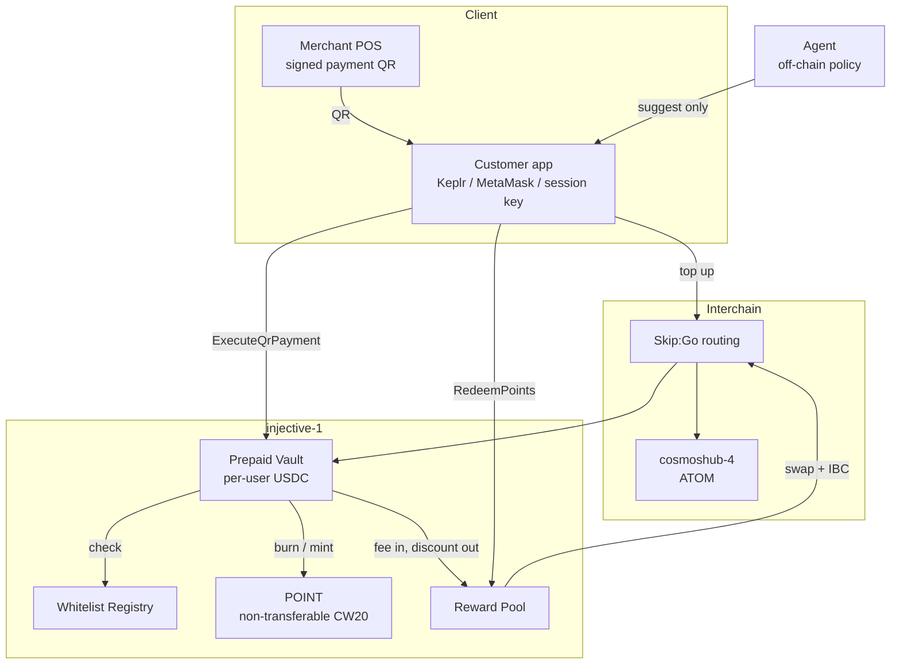

# agentic-qr-payment

**Non-custodial.** Prepay USDC into a vault only you can withdraw from, then pay approved cafes and restaurants by QR with no wallet popup and no gas fee, and earn points. An AI agent suggests how many points to keep or redeem and when to top up; you make every move yourself.

## In short

- **Top up:** USDC.inj on Injective goes straight in. USDC on Base, Ethereum or Solana is routed through [Skip:Go](https://go.skip.build/) into your own vault. The platform never holds your funds.
- **Pay:** The app checks the store's signature on the QR before paying. A payment-only key you register once (with limits) signs for you, and the platform pays the gas, so there is no popup and no fee. Each payment uses your points as a discount and earns new points.
- **Rewards:** You redeem points for ATOM or USDC.inj; ATOM is the best value; the AI agent sets the bonus once a day (+7% at start). Rewards are paid from a pool funded by merchant fees, never from user balances. The AI agent suggests how many points to keep and redeem, how much to top up and from which chain, and which store nearby gives extra points during a quiet hour.

This repository is a working demo. A Go server simulates the contracts in memory and serves the web UI. Skip:Go routes and transaction hashes are simulated; The ATOM price is live from CoinGecko; nothing is sent on-chain.

## Terms

| Term | Meaning |
| --- | --- |
| Non-custodial | The platform never holds or controls user funds; only the owner can withdraw |
| Vault | Your prepaid balance, held in a contract only you can withdraw from |
| USDC.inj | USDC on Injective, the currency used for payments |
| POINT | Reward points. 1 POINT = $0.01. They cannot be sent to other people |
| Session key (Tap to pay) | A payment-only key registered once on your Vault. It can pay approved stores within per-payment and daily limits, and cannot withdraw |
| Feegrant | A Cosmos SDK feature that lets the platform pay transaction fees for you |
| Whitelist Registry | The list of approved stores and the keys that sign their QR codes |
| Reward Pool | Money that pays for point discounts and redemptions, funded by merchant fees and sponsors |
| Happy hour | A daily window when a store gives extra points and pays for them |
| Agent | Gives suggestions only. It never moves funds or redeems points |

## Contents

- [Terms](#terms)
- [Goals](#goals)
- [Architecture](#architecture)
- [Contracts](#contracts)
- [Flows](#flows)
- [POINT economics](#point-economics)
- [Fee structure](#fee-structure)
- [Agent](#agent)
- [Skip:Go](#skipgo)
- [Prices](#prices)
- [Mintscan](#mintscan)
- [Wallets](#wallets)
- [Status](#status)
- [Run](#run)
- [Layout](#layout)
- [API](#api)
- [Data](#data)
- [Editing](#editing)

## Goals

| Goal | How |
| --- | --- |
| The platform never holds user funds | Each user's USDC sits in a Prepaid Vault that only the owner, or a capped session key the owner registered, can move |
| Paying at a counter feels like a card tap | A session key with per-payment and daily limits signs QR payments; gas is paid through `x/feegrant` |
| Only approved merchants can be paid | The Whitelist Registry is checked inside the payment transaction |
| Rewards bring users back to the same merchants | POINT is earned on payment and spent as a discount at whitelisted merchants |
| Rewards flow into the Cosmos ecosystem | POINT redeems to ATOM or USDC.inj; ATOM gets the highest value per point |
| User principal and reward funding stay separate | Redemptions and POINT discounts are paid from a Reward Pool funded by merchant fees and sponsors, never from user Vaults |

## Architecture



| Component | Role | In this repo |
| --- | --- | --- |
| Prepaid Vault | Holds each user's USDC; executes payments, refunds and withdrawals | `internal/engine/payment.go`, `vault.go` |
| Whitelist Registry | Merchant ID, status, settlement address, fee and earn rates | `internal/engine/admin.go`, `engine.go` |
| POINT | Non-transferable reward token; only minted on payment and burned on discount or redemption | `User.Points` in `internal/engine` |
| Reward Pool | Funds POINT discounts and redemptions; receives merchant fees and sponsor budget | `internal/engine/rewards.go`, `admin.go` |
| Session key | Key registered on the Vault with per-payment and daily limits, used for QR payments | `Session` in `internal/engine/types.go` |
| Agent | Advises on points, top-up and happy hours after each payment; never executes | `Advise` in `internal/engine/advisor.go` |
| Web UI | Customer app, merchant POS and operator view | `web/index.html` |

## Contracts

### Prepaid Vault

- One balance per user address. Only two signers can move funds:
  - The owner's wallet: deposit, withdraw, register or revoke a session key.
  - The owner's session key: `ExecuteQrPayment` only, within its limits.
- Withdrawal is owner-signed and is not affected by session limits or a Reward Pool pause.
- Session limits are enforced inside the contract, because `x/authz` cannot cap an amount passed as a contract argument and the contract cannot tell an authz call from a direct call. `x/feegrant` (`AllowedMsgAllowance` for `MsgExecuteContract` plus `PeriodicAllowance`) pays gas for session-key transactions.

| Message | Signer | Effect |
| --- | --- | --- |
| `DepositUsdc` | Owner, or Skip:Go post-route action | Adds USDC to the owner's Vault |
| `Withdraw` | Owner | Sends Vault USDC back to the owner |
| `RegisterSession` / `RevokeSession` | Owner | Sets or removes the session key and its limits |
| `ExecuteQrPayment` | Session key or owner | Atomic payment, see [Payment](#payment) |
| `RefundPayment` | Merchant | Reverses a payment within the refund window |

### Whitelist Registry

| Field | Type | Example |
| --- | --- | --- |
| `merchant_id` | string | `MRC_BAR_001` |
| `name` | string | Seongsu Pub |
| `category` | enum `CAFE`, `BAR`, `RESTAURANT`, `OTHER` | `BAR` |
| `status` | enum `ACTIVE`, `SUSPENDED` | `ACTIVE` |
| `settlement_addr` | inj1 address | `inj1abc...xyz` |
| `fee_bps` | u16 | `30` (0.30%, below the card rate for the merchant's tier) |
| `pool_bps` | u16 | `20` (part of `fee_bps` that goes to the Reward Pool; the rest is Skip:Go revenue) |
| `point_earn_bps` | u16 | `300` (3.0%) |
| `pubkey` | ed25519 public key (hex) | `5e916eaa...` |

Only `ACTIVE` merchants can be paid. `pubkey` verifies the merchant's QR signatures. Status changes are signed by the registry admin multisig.

### POINT

- 1 POINT = 0.01 USDC.
- Transfer and send are disabled. The only state changes are:
  - Mint on a successful whitelisted payment.
  - Burn as a payment discount.
  - Burn on redemption from the Reward Pool.

### Reward Pool

- Inflows: merchant fees, sponsor and marketing budget.
- Outflows: POINT discounts paid to merchants, redemptions including boost.
- Controls: per-user daily redeem cap and pause (operator); the bonus per asset is set by the AI agent (see [Redeem bonus agent](#redeem-bonus-agent)). A pause stops POINT discounts and redemptions only; user Vaults keep working.
- Bonus rule: every update must keep net value ATOM > USDC.inj after route cost and keep the pool covering all outstanding POINT.

## Flows

### Top up

1. The client asks Skip:Go for a route from the source chain's USDC to injective-1 USDC.
2. The user's wallet signs on the source chain.
3. Skip:Go delivers USDC and calls `Vault.DepositUsdc` for the user as the post-route action.

From an Injective wallet the deposit is direct, with no route.

### Payment

The merchant POS shows a signed QR (MPM v2.0):

```json
{
  "qr_version": "2.0",
  "merchant_id": "MRC_BAR_001",
  "order_id": "ORD_20261123_0042",
  "amount_usdc": "12.50",
  "currency": "USDC.inj",
  "expires_at": 1795395000,
  "merchant_sig": "0x..."
}
```

QR authentication: the merchant POS signs the canonical string below with its ed25519 private key. The app sends the whole scanned payload, and the contract verifies `merchant_sig` with the `pubkey` registered for `merchant_id`. Changing any field, such as the amount, breaks the signature.

```
qr_version|merchant_id|order_id|amount_usdc|currency|expires_at
```

Before paying, the app shows five checks from `/api/qr/verify`: store signature, approved store, pays in USDC.inj, not expired, order not paid yet.

`ExecuteQrPayment` runs these checks and changes in one transaction. If any check fails, nothing moves.

1. `merchant_sig` verifies against the registered `pubkey`.
   `currency` must be `USDC.inj`; any other value is rejected with `ERR_BAD_CURRENCY`.
2. Merchant is `ACTIVE` in the registry.
3. QR has not expired (120 seconds).
4. `order_id` has not been paid.
5. Split the amount:

   ```
   A        = order amount
   P_used   = min(user POINT, floor(A / 0.01))      if "use POINT first" is on
   A_point  = P_used * 0.01
   A_usdc   = A - A_point
   ```

6. Session limits: `A_usdc <= per_payment_limit` and `spent_today + A_usdc <= daily_limit`.
7. Vault balance `>= A_usdc`, and Reward Pool balance `>= A_point`.
8. Move funds and POINT:

   ```
   fee       = A_usdc * fee_bps / 10000
   P_earned  = floor((A_usdc * point_earn_bps + A * extra_bps) / 10000 / 0.01)   # extra_bps only during a happy hour

   Vault           -A_usdc
   POINT           -P_used (burn), +P_earned (mint)
   Merchant        +(A_usdc - fee) + A_point
   Reward Pool     +pool_fee - A_point        # pool_fee = A_usdc * pool_bps / 10000 (+ happy hour fee)
   Skip:Go         +fee - pool_fee
   ```

The merchant always receives the full order amount minus the fee; the POINT portion is paid by the Reward Pool.

Rejection codes: `ERR_MERCHANT_NOT_WHITELISTED`, `ERR_QR_EXPIRED`, `ERR_ORDER_ALREADY_PAID`, `ERR_BAD_SIGNATURE`, `ERR_SESSION_TX_LIMIT`, `ERR_SESSION_DAILY_LIMIT`, `ERR_INSUFFICIENT_VAULT`, `ERR_POOL_INSUFFICIENT`.

### Refund

The merchant signs `RefundPayment` within 10 minutes of the payment.

```
POINT       +P_used (re-mint), -min(P_earned, current POINT) (burn)
Vault       +A_usdc - (POINT earned but already redeemed) * 0.01
Merchant    -(A - fee)
Reward Pool +A_point - pool_fee + (already redeemed POINT) * 0.01
Skip:Go     -(fee - pool_fee)
```

### Redeem

1. The user burns POINT through `RewardPool.RedeemPoints`, signed with their own wallet. The agent can only suggest.
2. The pool pays `value + boost`, where `value = POINT * 0.01`.
3. The payout is routed by target:
   - ATOM: Skip:Go swaps USDC to `uatom` and sends it over IBC to the user's `cosmos1` address.
   - USDC.inj: credited to the user's Vault, and the next payment earns +1% POINT.
4. Checks: pool not paused, per-user daily redeem cap, pool balance.

### Withdraw

The owner signs `Vault.Withdraw` to send USDC back to their own address. No limit or pause applies.

## POINT economics

| Parameter | Demo value |
| --- | --- |
| POINT value | 1 POINT = 0.01 USDC |
| Earn rate | `point_earn_bps` of the USDC-paid amount, equal to the pool share: 0.20% (small stores), 0.40% and 0.45% (restaurants); happy hour adds 2-3% of the order |
| Redeem boost | Set by the AI agent daily at 00:00 KST, starting at ATOM +7%; USDC.inj 0% (+1% earn on next payment) |
| Route cost (sample) | ATOM 0.6%, USDC.inj 0% |
| Daily redeem cap | $50 per user |

Value of 1,000 POINT ($10.00) with demo settings:

| Target | Boost | Route cost | Net value | Amount at CoinGecko price on 2026-11-23 |
| --- | --- | --- | --- | --- |
| ATOM ($1.18) | +$0.70 | -$0.0642 | $10.6358 | 9.0134 ATOM |
| USDC.inj | $0 | $0 | $10.00 | 10.00 USDC.inj |

The operator view shows pool coverage: `pool balance / (outstanding POINT * 0.01)`.

## Fee structure

### Fees in the demo

| Fee | Payer | Rate | Goes to |
| --- | --- | --- | --- |
| Merchant fee | Merchant | Tiered, below card rates: 0.30% (small stores), 0.60% and 0.70% (restaurants) of `A_usdc` | `pool_bps` to the Reward Pool (0.20%, 0.40%, 0.45%), the rest to Skip:Go |
| Top-up route fee (sample) | User | Ethereum 0.4%, Solana 0.2%, Base 0.1%, Injective 0% | Route |
| Redeem route cost (sample) | Reward Pool | ATOM 0.6% | Route |
| Happy hour fee | Merchant | `extra_bps` of the order amount during the merchant's happy hour | Reward Pool (funds the extra POINT) |
| Gas | Platform | Per transaction, via feegrant | Validators |

The demo uses the target model's tiers. Base earn equals the pool share, so payments alone keep the pool funded; for example a $30 restaurant order (0.60% fee) sends $0.12 to the pool, $0.06 to Skip:Go and mints 12 POINT ($0.12).

### Target model

Merchant fees are set below the Korean credit card rate for each revenue tier, so accepting this payment is always cheaper than a card.

Korean credit card rates for SMEs are capped by the Financial Services Commission (preferential rates from 2025-02-14). General merchants above KRW 3B in annual sales have no cap; their rates are published by each card issuer.

| Merchant tier (annual sales) | Card rate (credit) | Our merchant fee | Reward Pool share | Skip:Go share | Base POINT earn |
| --- | --- | --- | --- | --- | --- |
| Small, KRW 0.3B or less | 0.40% | 0.30% | 0.20% | 0.10% | 0.20% |
| SME, KRW 0.3-0.5B | 1.00% | 0.60% | 0.40% | 0.20% | 0.40% |
| SME, KRW 0.5-1B | 1.15% | 0.70% | 0.45% | 0.25% | 0.45% |
| SME, KRW 1-3B | 1.45% | 0.90% | 0.60% | 0.30% | 0.60% |
| General, over KRW 3B | Not capped (issuer disclosure) | 1.10% | 0.70% | 0.40% | 0.70% |

Fees are charged on `A_usdc` (the part paid in USDC.inj). The base POINT earn equals the Reward Pool share, and the POINT-paid portion earns nothing, so normal payments never drain the pool.

Other items:

| Item | Rate | Payer | Destination |
| --- | --- | --- | --- |
| ATOM bonus | Set by the AI agent daily within 3-10% (start +7%) | Ecosystem sponsor budget | User |
| Happy hour | Extra POINT the merchant chooses (`extra_bps`) | Merchant | User, through the Reward Pool |
| Skip:Go route fee | 0.2-0.3% on top-up and redemption routes | User (top-up), Reward Pool (redemption) | Skip:Go |
| POINT expiry | Unused for 12 months | - | Returned to the Reward Pool |

Rules:

- Merchant fee < card rate in every tier.
- Base POINT earn = Reward Pool share, so the pool stays funded by payments alone.
- The ATOM bonus is paid by sponsors who benefit from the inflow and always keeps ATOM above USDC.inj after route cost.
- Extra rewards beyond the base earn come from merchants (happy hour) or sponsors (asset bonuses), not from Skip:Go.

Example, $10 order paid in USDC at a small merchant (KRW 0.3B or less):

| Line | Amount |
| --- | --- |
| Card fee for comparison (0.40%) | $0.040 |
| Our merchant fee (0.30%) | $0.030 |
| Reward Pool (0.20%) | $0.020 |
| Skip:Go (0.10%) | $0.010 |
| POINT minted (0.20%) | 2 P = $0.02 liability |
| Merchant receives | $9.970 |

Same order at an SME (KRW 0.3-0.5B): fee $0.060 (card $0.100), Reward Pool $0.040, Skip:Go $0.020, 4 P minted, merchant receives $9.940.

Skip:Go break-even per month:

```
fixed cost <= orders x (avg order x Skip:Go share - gas per payment) + route volume x route fee
```

For example, with a $10 average order, a 0.20% Skip:Go share and gas ignored, each payment earns $0.02. A $200 monthly server cost needs 10,000 payments ($100,000 GMV) from merchant fees alone, or less with route fees on top-ups and redemptions.

The base earn (0.2-0.7%) is small by design to keep merchant fees below card rates. The consumer's larger rewards come from happy hours and asset bonuses.

For comparison, Zero Pay (Korea's government-backed QR payment) charges 0% to small merchants up to KRW 0.8B in annual sales, so this model does not compete on fee alone at that tier; it competes on self-custody, instant on-chain settlement and asset rewards.

### Merchant value

- Settlement goes to `settlement_addr` in the same transaction as the payment.
- No chargebacks; only the merchant can sign a refund.
- POINT can only be spent at whitelisted merchants, which brings customers back.
- Accepts customers who hold USDC but no local card.

## Agent

The agent advises; the user decides. Its wording is limited to payment discounts and reward value at redemption: it never suggests buying or holding an asset for gains or mentions price movements. It never redeems POINT, moves funds or changes limits. Each suggestion can open the matching screen with values filled in, and the user confirms and signs there.

After each payment, or when the user presses **Ask agent**, `POST /api/advice` returns three suggestions:

| Suggestion | What the agent decides | Inputs |
| --- | --- | --- |
| Points | How many POINT to keep for upcoming discounts and how many to redeem, and to which asset | POINT balance, suggestion point, average order, redeem value per asset |
| Top up | Whether the balance runs short within a week of usual orders, how much to add, and from which chain | Balance, average order, orders per week, USDC held per chain, route fee per chain |
| Happy hour | One store with extra points worth visiting, preferring stores open now and near the user | Today's merchant happy hours, user area |

How it decides:

1. The server computes the facts above from engine state. Addresses and keys are not included.
2. If `ANTHROPIC_API_KEY` is set, Claude receives the facts and returns a JSON decision (structured output). The model is `AGENT_MODEL`, default `claude-opus-5-5`, at low effort with server-side refusal fallback.
3. The server validates the decision: kept + redeemed POINT equals the balance, the asset and chain exist, the top-up is $1-500, and the store has a happy hour today.
4. Without a key, on timeout (20 s) or on a failed check, rule-based advice is returned instead. The card shows **AI** with the model name or **Rule-based**.

Rule-based baseline: keep POINT worth two average orders; top up to one week of spending, rounded up to $10, from the cheapest chain that holds enough; pick the happy hour scored by open now (+2) and same area (+1).

### Redeem bonus agent

The bonus works like a daily rate, as exchanges and staking programs publish rewards: it is fixed for the day and users see when it changes next.

- **Daily update:** at 00:00 KST (and at server start) the agent sets the ATOM bonus for the next 24 hours. Operators cannot edit it; the operator column shows the bonus, who set it (AI or rules), why, and the next update time. The Redeem screen shows "bonus fixed until 00:00 KST".
- **Emergency cut:** every 5 minutes the server checks coverage only. If the pool no longer covers outstanding POINT plus the ATOM bonus, the agent lowers the bonus at once. Raises happen only at the daily update.
- **Grace for users:** for 2 minutes after any change, a redemption gets the better of the old and new bonus, so a user never gets less than the value they just reviewed.
- To stop rewards entirely, the operator uses **Pause rewards**.

Inputs: Reward Pool balance, outstanding POINT value, coverage, redeemed value per asset, route cost per asset, current bonus. Claude decides when `ANTHROPIC_API_KEY` is set; otherwise, or when the answer breaks a guardrail, the rule-based value is used.

Guardrails enforced in code (`internal/engine/boost.go`):

- ATOM 3-10%: the floor keeps ATOM clearly above USDC.inj after route cost; the ceiling caps sponsor cost. The floor yields only when the pool cannot cover it (solvency first)
- Each update moves a bonus by at most 2 percentage points
- Net value after route cost: ATOM > USDC.inj
- Pool balance >= outstanding POINT value x (1 + ATOM bonus)

Rule-based fallback: ATOM about 6 points above its route cost (one more if ATOM is under half of redeemed value), capped by what the pool covers with a 20% buffer. Each change is logged as `RewardPool.SetBoost` with signer `bonus agent` and the kind (`daily` or `emergency`).

### Happy hour

A merchant-approved daily window that adds extra POINT (`extra_bps`). The merchant pays it as an extra fee into the Reward Pool, so the pool stays funded:

```
earn_bps = point_earn_bps + extra_bps
fee      = A_usdc * fee_bps / 10000 + A * extra_bps / 10000
```

## Skip:Go

[Skip:Go](https://go.skip.build/) provides the cross-chain routes. The demo simulates its calls and labels each screen that uses it.

| Flow | Route | Simulated call |
| --- | --- | --- |
| Top up USDC on Base (8453), Ethereum (1) or Solana (`solana`) | USDC -> injective-1 USDC.inj, then `Vault.DepositUsdc` as the post-route action | `SkipClient.route()`, `SkipClient.executeRoute()` |
| Top up USDC.inj on Injective (default) | Direct deposit, no route | `Vault.DepositUsdc` |
| Redeem POINT to ATOM | injective-1 USDC -> cosmoshub-4 `uatom`, IBC transfer to the user's `cosmos1` address | `RewardPool.RedeemPoints` |
| Redeem POINT to USDC.inj | No route, credited to the Vault | `RewardPool.RedeemPoints` |

Route fees come from `routeFeeBps` and `topupChains` in `internal/engine/types.go` and are sample values, not live Skip:Go quotes. The ATOM price is live (see [Prices](#prices)).

## Prices

The ATOM USD price come from the CoinGecko public API (`/api/v3/simple/price`, id `cosmos`), fetched at server start and every 5 minutes (`internal/engine/prices.go`). USDC.inj is fixed at $1.

- The Redeem screen shows the prices in use, the source and the update time.
- If CoinGecko does not answer (timeout 5 s, rate limit, no network), the last fetched prices stay in use; before the first success the sample prices in `price` (`types.go`) are used and the screen says so.
- Prices change only how many ATOM a redemption returns. The value in USD, the bonus and the comparison with USDC.inj do not depend on them.
- Set `COINGECKO_API_KEY` to send a CoinGecko demo API key (`x-cg-demo-api-key`) for higher rate limits.

## Mintscan

Each simulated contract call (`Vault.*`, `RewardPool.*`, `Registry.*`) gets a 64-character transaction hash. A rejected payment also gets one, as a reverted transaction would. The activity list, payment receipt and on-chain activity log link to:

```
https://www.mintscan.io/injective/tx/<TX_HASH>
```

The hashes are generated locally, so Mintscan shows "not found" until the contracts are deployed and real hashes are returned. Off-chain steps (route quotes, wallet connect, agent policy) have no hash.

## Wallets

| Wallet | Addresses used | Notes |
| --- | --- | --- |
| Keplr | `inj1` from injective-1, `cosmos1` from cosmoshub-4 | ATOM goes to the Keplr `cosmos1` address |
| MetaMask | `0x` address converted to `inj1` (same 20 bytes, bech32) | MetaMask has no `cosmos1` address; ATOM goes to the demo address |

Wallet connect reads addresses only. Balances stay simulated and no signature is requested.

## Status

### Working in the demo

| Area | What works |
| --- | --- |
| Users | Three demo users, each with their own Vault balance, POINT, ATOM, session, policy and activity |
| Top up | Quote and deposit of USDC.inj on Injective (default, direct) or USDC on Base, Ethereum or Solana (simulated Skip:Go route); Skip:Go-style asset picker |
| Payment | Merchant QR (MPM v2.0) with ed25519 signature, 120 s expiry and one-time `order_id`; preview before paying; POINT-first discount; fee to the Reward Pool; POINT minted in the same transaction |
| QR authentication | Four checks shown in the app; a forged QR (amount changed) fails the signature check and is rejected |
| Rejections | Forged QR, suspended merchant, expired QR, reused order, session per-payment and daily limits, insufficient Vault balance, insufficient Reward Pool |
| Screens | One page: customer app (switch demo users from the name at the top), merchant (POS and today's sales with refund) and operator (totals, rewards pool, stores, activity) |
| Refund | Merchant-signed cancel within 10 minutes; POINT used is returned, POINT earned is removed, already-redeemed POINT is deducted from the refund |
| Withdraw | Owner-signed, not affected by session limits or a pool pause |
| Session key | Grant, revoke, per-payment and daily limits; daily counters reset when the date changes |
| Redeem | ATOM or USDC.inj with boost, daily cap and pool checks; ATOM marked as best value |
| ATOM preference | Bonus set daily by the AI agent within guardrails (start ATOM +7%); USDC.inj 0% with +1% earn on the next payment; the Redeem screen shows each bonus and the net gain over USDC.inj (for example ATOM +7% bonus, +6.4% vs USDC.inj) |
| Agent | Advice on points to keep or redeem, top-up amount and cheapest chain, and a nearby happy hour; Claude when a key is set, rules otherwise; each suggestion opens a pre-filled screen and the user confirms |
| Happy hour | Merchant-paid extra POINT during a daily window, shown on the POS, receipt and operator store table |
| Operator | Reward Pool balance, coverage, inflow and outflow totals, daily redeem cap, budget top-up, pause, read-only view of the AI-set bonus with its reason, merchant approve/suspend |
| Wallets | Keplr (`inj1` and `cosmos1`) and MetaMask (`0x` converted to `inj1`), address only |
| Links | Skip:Go attribution on routed screens; Mintscan link for every simulated contract transaction |

### Not implemented

| Area | Current state |
| --- | --- |
| Contracts | Go in-memory simulation; no CosmWasm contracts deployed |
| Skip:Go | Calls are simulated; no live routes, quotes or execution |
| Prices | Live CoinGecko spot prices; redemptions do not use a Skip:Go quote or slippage limit yet |
| Transaction hashes | Generated locally; Mintscan shows "not found" |
| Wallet signing | Wallet connect reads addresses only; no transaction is signed |
| MetaMask and ATOM | MetaMask has no `cosmos1` address; ATOM goes to the demo address |
| QR | Merchant-presented only; the QR is a drawn pattern, not scannable; no camera scanner; no customer-presented (CPM) QR |
| Merchant keys | Generated by the server at startup; in production each POS holds its own private key |
| Fee model | Tiered fees and the pool/Skip:Go split are built; Skip:Go route fees, sponsor funding of bonuses (bonuses are paid from the pool) and POINT expiry are not |
| Accounts | Demo users are switched from a menu; there are no accounts or logins |
| Agent inputs | Spending profiles, wallet holdings per chain, areas and happy hours are sample data; wallet balances are not read from chains |
| Persistence | State resets when the server restarts |

### Differences from the v2 spec

| Item | v2 spec | Demo |
| --- | --- | --- |
| Redeem boost | ATOM +5%, INJ +5% | ATOM only (+7% at start, 3-10%), INJ redemption removed so rewards flow to the Cosmos Hub |
| Boost rule | Not defined | Set only by the AI agent, daily at 00:00 KST with emergency cuts, within code-enforced guardrails; no manual override |
| Session limits | `x/authz` delegation | Limits enforced in the Vault contract; `x/feegrant` pays gas |
| Pause | Not defined | Pauses the Reward Pool only; Vault payments without POINT and withdrawals keep working |
| Refund | Not defined | Merchant-signed, 10-minute window |
| Earn base | Total order amount | USDC-paid amount, so POINT-paid parts earn nothing (happy hour extra applies to the whole order) |

## Run

Requires Go 1.25 or later.

```sh
go run ./cmd/server
```

Open http://127.0.0.1:8080. Use `-addr` to change the listen address.

| Environment variable | Purpose |
| --- | --- |
| `ANTHROPIC_API_KEY` | Enables AI advice; without it the agent uses rules |
| `AGENT_MODEL` | Claude model for advice (default `claude-opus-5-5`) |
| `COINGECKO_API_KEY` | Optional CoinGecko demo API key for the price feed |

Demo path:

1. On the merchant POS, choose a store and press **Show payment QR**.
2. In the app, press **Pay**, check the QR verification and preview, and confirm.
3. Choose **Mangwon Bistro** (suspended) and pay to see the rejection.
4. Open **Redeem** and convert POINT to ATOM.
5. Pay again with **Use points first** on.
6. Check the merchant and operator columns; refund a payment from the merchant column.

## Layout

```
cmd/server/        HTTP server entry point
internal/engine/   Contract simulation: payment, refund, vault, rewards, wallet, admin, advisor
internal/api/      JSON HTTP handlers
web/               Static UI (embedded into the binary)
```

## API

| Method | Path | Purpose |
| --- | --- | --- |
| GET | `/api/state` | Users, merchants, Reward Pool, boost and event log |
| GET | `/api/redeem/quote?points=N` | Value of N POINT per target asset |
| POST | `/api/topup/quote`, `/api/topup` | Top-up quote and deposit into the Vault |
| POST | `/api/withdraw` | Owner withdrawal from the Vault |
| POST | `/api/session` | Grant or revoke the session key |
| POST | `/api/policy` | Session limits and the agent's suggestion point |
| POST | `/api/wallet/connect`, `/api/wallet/disconnect` | Use Keplr or MetaMask addresses for a user |
| POST | `/api/advice` | Agent advice for a user |
| POST | `/api/qr` | Merchant-signed payment QR |
| POST | `/api/qr/verify` | QR authentication checks for a scanned payload |
| POST | `/api/pay/preview` | Payment split without changing state (`qr` payload) |
| POST | `/api/pay` | Atomic QR payment (`qr` payload) |
| POST | `/api/refund` | Merchant-signed refund of a payment |
| POST | `/api/redeem` | Burn POINT and receive ATOM or USDC.inj |
| POST | `/api/merchants/status` | Toggle merchant ACTIVE/SUSPENDED |
| POST | `/api/pool/cap`, `/api/pool/fund`, `/api/pool/pause` | Reward Pool settings |

Errors return `{"error":{"code":"ERR_...","message":"..."}}`. History entries and contract events include `tx_hash`. `/api/state` also returns `stats` (platform totals) and per-merchant `orders`, `sales_micro`, `fees_micro`, `point_comp_micro` and `refunds`. Amounts ending in `_micro` are in units of 0.000001 USDC.

## Data

Sample data is defined in `internal/engine`:

| Constant | Purpose |
| --- | --- |
| `price` (`types.go`) | Fallback USD prices used until CoinGecko answers |
| `routeFeeBps` (`types.go`) | Sample swap and IBC cost per target asset |
| `topupChains` (`types.go`) | Top-up sources (USDC.inj on injective-1, USDC on Base, Ethereum and Solana) and route fees |
| `merchants` (`engine.go`) | Registry entries: status, `fee_bps`, `point_earn_bps`, settlement address |
| `newUser(...)` calls (`engine.go`) | Demo users, starting Vault balance and POINT |
| `pool` (`engine.go`) | Starting Reward Pool balance, daily redeem cap and feegrant gas pool |
| `seedSample` (`advisor.go`) | Sample user areas, spending profiles, USDC per chain, and merchant areas and happy hours |
| `boostBps` (`engine.go`) | Starting bonus per asset in bps; the agent updates it (`boost.go`) |
| `QRTTL`, `RefundWindow` (`types.go`) | QR expiry (120 s) and refund window (10 min) |

## Editing

1. Change the values above in `internal/engine`.
2. Restart the server with `go run ./cmd/server`.

The redeem bonus is not edited by hand; the agent sets it daily at 00:00 KST (see [Redeem bonus agent](#redeem-bonus-agent)).
