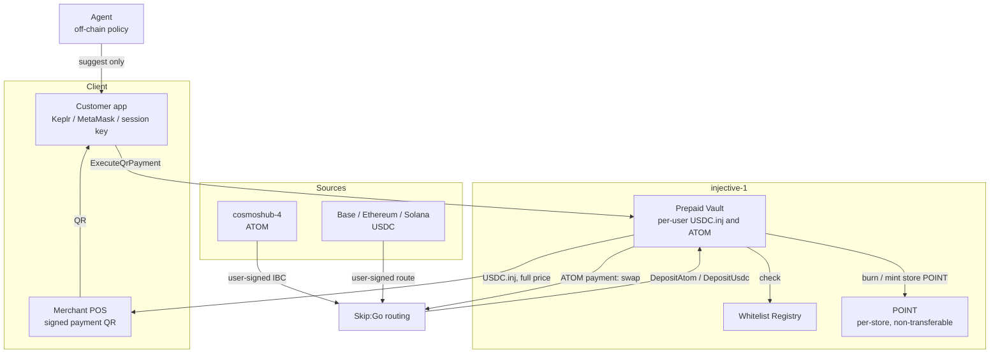

# agentic-qr-payment

**Non-custodial.** Keep USDC.inj and ATOM in a vault only you can withdraw from, then pay approved cafes and restaurants by QR with either one, with no wallet popup and no gas fee. Each store gives its own points back as a discount on your next visit. An AI agent suggests when and from where to top up and which store has a happy hour; you make every move yourself.

## In short

- **Top up:** USDC.inj on Injective goes straight in. USDC on Base, Ethereum or Solana is routed through [Skip:Go](https://go.skip.build/) into your vault as USDC.inj; ATOM on the Cosmos Hub is moved over IBC and kept as ATOM. You sign the route in your own wallet.
- **Pay:** The app checks the store's signature on the QR before paying. Pay with USDC.inj, or with ATOM: Skip:Go swaps just enough ATOM to USDC.inj inside the payment, with a 1% slippage limit. A payment-only key you register once (with limits) signs for you, and the platform pays the gas, so there is no popup. The store always receives the full price in USDC.inj in the same transaction, and paying with ATOM earns more than twice the store points (7% vs 3% at every store in the demo).
- **Points:** Each store gives its own points, usable only as a discount at that store. Points are never converted to coins, and the platform never sends crypto to users or merchants.
- **Platform revenue:** Skip:Go (our routing service) earns route fees on top-ups and ATOM payment swaps. Merchants: free for KRW 0.3B or less in annual sales, KRW 30,000 a month for KRW 0.3-0.5B. Merchants pay no per-payment fee.

This repository is a working demo. A Go server simulates the contracts in memory and serves the web UI. Skip:Go routes and transaction hashes are simulated; the ATOM price is live from CoinGecko; nothing is sent on-chain.

## Terms

| Term | Meaning |
| --- | --- |
| Non-custodial | The platform never holds or controls user funds; only the owner can withdraw |
| Vault | Your prepaid USDC.inj and ATOM, held in a contract only you can withdraw from |
| USDC.inj | USDC on Injective; QR prices and merchant settlement are in USDC.inj |
| ATOM | Cosmos Hub ATOM held on Injective over IBC; payable at stores through a Skip:Go swap |
| Skip:Go | Our cross-chain routing and swap service |
| POINT | Store points. 1 POINT = $0.01 off at the store that gave it. They cannot be sent to other people or converted to coins |
| Session key (Tap to pay) | A payment-only key registered once on your Vault. It can pay approved stores within per-payment and daily limits, and cannot withdraw |
| Feegrant | A Cosmos SDK feature that lets the platform pay transaction fees for you |
| Whitelist Registry | The list of approved stores and the keys that sign their QR codes |
| Happy hour | A daily window when a store gives extra points |
| Subscription | Monthly software fee in KRW, billed off-chain; free for the smallest tier |
| Agent | Gives suggestions only. It never moves funds |

## Contents

- [Terms](#terms)
- [Goals](#goals)
- [Architecture](#architecture)
- [Contracts](#contracts)
- [Flows](#flows)
- [POINT](#point-1)
- [Fee structure](#fee-structure)
- [Agent](#agent)
- [Skip:Go](#skipgo)
- [Prices](#prices)
- [Mintscan](#mintscan)
- [Wallets](#wallets)
- [Status](#status)
- [Run](#run)
- [Layout](#layout)
- [API](#api)
- [Data](#data)
- [Editing](#editing)

## Goals

| Goal | How |
| --- | --- |
| The platform never holds user funds | Each user's USDC.inj and ATOM sit in a Prepaid Vault that only the owner, or a capped session key the owner registered, can move |
| The platform never sends crypto to users or merchants | Payments go from the Vault straight to the merchant; points are discounts, not coins |
| Paying at a counter feels like a card tap | A session key with per-payment and daily limits signs QR payments; gas is paid through `x/feegrant` |
| Only approved merchants can be paid | The Whitelist Registry is checked inside the payment transaction |
| Rewards bring users back to the same merchant | Each store's POINT is spent only at that store |
| ATOM holders can pay at a store without selling first | ATOM is kept in the Vault and swapped by Skip:Go only for the amount of each payment; the store still gets a fixed USDC.inj price |

## Architecture



| Component | Role | In this repo |
| --- | --- | --- |
| Prepaid Vault | Holds each user's USDC.inj and ATOM; executes payments (with a Skip:Go swap for ATOM), refunds and withdrawals | `internal/engine/payment.go`, `vault.go` |
| Whitelist Registry | Merchant ID, status, settlement address, earn rate | `internal/engine/admin.go`, `engine.go` |
| POINT | Non-transferable store points; minted on payment at a store and burned only as a discount at the same store | `User.Points` (per merchant ID) in `internal/engine` |
| Session key | Key registered on the Vault with per-payment and daily limits, used for QR payments | `Session` in `internal/engine/types.go` |
| Agent | Advises on top-up and happy hours after each payment; never executes | `Advise` in `internal/engine/advisor.go` |
| Web UI | Customer app, merchant POS and operator view | `web/index.html` |

## Contracts

### Prepaid Vault

- One balance per user address. Only two signers can move funds:
  - The owner's wallet: deposit, withdraw, register or revoke a session key.
  - The owner's session key: `ExecuteQrPayment` only, within its limits.
- Withdrawal is owner-signed and is not affected by session limits.
- Session limits are enforced inside the contract, because `x/authz` cannot cap an amount passed as a contract argument and the contract cannot tell an authz call from a direct call. `x/feegrant` (`AllowedMsgAllowance` for `MsgExecuteContract` plus `PeriodicAllowance`) pays gas for session-key transactions.

| Message | Signer | Effect |
| --- | --- | --- |
| `DepositUsdc` | Owner, or Skip:Go post-route action | Adds USDC.inj to the owner's Vault |
| `DepositAtom` | Owner, or Skip:Go post-route action | Adds IBC ATOM to the owner's Vault |
| `Withdraw` | Owner | Sends USDC.inj or ATOM back to the owner |
| `RegisterSession` / `RevokeSession` | Owner | Sets or removes the session key and its limits |
| `ExecuteQrPayment` | Session key or owner | Atomic payment, see [Payment](#payment) |
| `RefundPayment` | Merchant | Reverses a payment within the refund window |

### Whitelist Registry

| Field | Type | Example |
| --- | --- | --- |
| `merchant_id` | string | `MRC_BAR_001` |
| `name` | string | Seongsu Pub |
| `category` | enum `CAFE`, `BAR`, `RESTAURANT`, `OTHER` | `BAR` |
| `status` | enum `ACTIVE`, `SUSPENDED` | `ACTIVE` |
| `settlement_addr` | inj1 address | `inj1abc...xyz` |
| `point_earn_bps` | u16 | `300` (3.00% of the paid amount) |
| `atom_bonus_bps` | u16 | `400` (+4.00% extra when paying with ATOM) |
| `pubkey` | ed25519 public key (hex) | `5e916eaa...` |

Only `ACTIVE` merchants can be paid. `pubkey` verifies the merchant's QR signatures. Status changes are signed by the registry admin multisig. The subscription is billed off-chain and is not part of the registry.

### POINT

- 1 POINT = $0.01 off at the issuing store.
- Balances are kept per user and per merchant. Points from one store cannot be used at another.
- Transfer and send are disabled. The only state changes are:
  - Mint on a successful payment at the store.
  - Burn as a payment discount at the same store.
  - Re-mint or burn on a refund at that store.

## Flows

### Top up

1. The client asks Skip:Go for a route: USDC on Base, Ethereum or Solana to injective-1 USDC.inj, or ATOM on cosmoshub-4 to injective-1 over IBC.
2. The user's wallet signs on the source chain.
3. Skip:Go transfers (and swaps USDC routes), then calls `Vault.DepositUsdc` or `Vault.DepositAtom` for the user as the post-route action.

From an Injective wallet the deposit is direct, with no route.

### Payment

The merchant POS shows a signed QR (MPM v2.0):

```json
{
  "qr_version": "2.0",
  "merchant_id": "MRC_BAR_001",
  "order_id": "ORD_20261123_0042",
  "amount_usdc": "12.50",
  "currency": "USDC.inj",
  "expires_at": 1795395000,
  "merchant_sig": "0x..."
}
```

QR authentication: the merchant POS signs the canonical string below with its ed25519 private key. The app sends the whole scanned payload, and the contract verifies `merchant_sig` with the `pubkey` registered for `merchant_id`. Changing any field, such as the amount, breaks the signature.

```
qr_version|merchant_id|order_id|amount_usdc|currency|expires_at
```

Before paying, the app shows five checks from `/api/qr/verify`: store signature, approved store, pays in USDC.inj, not expired, order not paid yet.

`ExecuteQrPayment` runs these checks and changes in one transaction. If any check fails, nothing moves.

1. `merchant_sig` verifies against the registered `pubkey`.
   `currency` must be `USDC.inj`; any other value is rejected with `ERR_BAD_CURRENCY`.
2. Merchant is `ACTIVE` in the registry.
3. QR has not expired (120 seconds).
4. `order_id` has not been paid.
5. Split the amount:

   ```
   A        = order amount
   P_used   = min(user POINT, floor(A / 0.01))      if "use POINT first" is on
   A_point  = P_used * 0.01
   A_usdc   = A - A_point
   ```

6. Session limits: `A_usdc <= per_payment_limit` and `spent_today + A_usdc <= daily_limit`.
7. Pay with (`pay_with`):
   - `USDC_INJ`: Vault USDC.inj `>= A_usdc`.
   - `ATOM`: Skip:Go quotes an exact-out swap on injective-1:

     ```
     ATOM_in  = ceil(A_usdc / ATOM_price / (1 - swap_fee))   # swap_fee 0.30% (sample)
     ATOM_max = ATOM_in * 1.01                               # shown in the preview, sent with the payment
     ```

     The payment reverts with `ERR_SLIPPAGE` if `ATOM_in` at execution exceeds the `ATOM_max` the user approved, and with `ERR_INSUFFICIENT_VAULT` if the Vault holds less ATOM.
8. Move funds and POINT:

   ```
   P_earned  = floor((A_usdc * (point_earn_bps + atom_bonus_bps) + A * extra_bps) / 10000 / 0.01)
               # atom_bonus_bps only when paying with ATOM, extra_bps only during a happy hour

   Vault           -A_usdc USDC.inj, or -ATOM_in ATOM (Skip:Go swaps it to A_usdc USDC.inj)
   POINT (store)   -P_used (burn), +P_earned (mint)
   Merchant        +A_usdc USDC.inj
   ```

`P_used` counts only the user's POINT at this store. The merchant receives everything the user pays, in USDC.inj, whichever asset the user chose; the POINT discount is the merchant's own promotion cost. Session limits are the same for both assets; paying with ATOM adds `atom_bonus_bps` to the earn rate.

Rejection codes: `ERR_MERCHANT_NOT_WHITELISTED`, `ERR_QR_EXPIRED`, `ERR_ORDER_ALREADY_PAID`, `ERR_BAD_SIGNATURE`, `ERR_BAD_CURRENCY`, `ERR_BAD_ASSET`, `ERR_SESSION_TX_LIMIT`, `ERR_SESSION_DAILY_LIMIT`, `ERR_INSUFFICIENT_VAULT`, `ERR_SLIPPAGE`.

### Refund

The merchant signs `RefundPayment` within 10 minutes of the payment.

```
POINT (store) +P_used (re-mint), -min(P_earned, current store POINT) (burn)
Vault         +A_usdc - (POINT earned but already spent at the store) * 0.01
Merchant      -(same amount as the Vault receives)
```

Refunds are paid in USDC.inj, also for payments made with ATOM.

### Withdraw

The owner signs `Vault.Withdraw` to send USDC.inj or ATOM back to their own address. No limit applies.

## POINT

| Parameter | Demo value |
| --- | --- |
| POINT value | 1 POINT = $0.01 off at the issuing store |
| Earn rate | `point_earn_bps` of the paid amount (POINT-paid parts excluded): 3% at every store; happy hour adds 3% of the order. Above card rewards; with ATOM, close to a stamp card (buy 10, get 1 free is about 9.1%) |
| ATOM bonus | `atom_bonus_bps`, +4% at every store (7% in total), added when paying with ATOM; with the 0.30% swap fee the customer nets +3.70% over USDC.inj |
| Example | $5.00 at any store: 15 POINT ($0.15) with USDC.inj, 35 POINT ($0.35) with ATOM |
| Merchant cost | Only when POINT is spent at the store, as a discount; unspent POINT costs nothing |
| Where it can be spent | Only at the store that gave it |
| Conversion | None; POINT is never redeemed for coins or cash |

The operator view shows unused POINT at face value (`totals.liability_micro`), summed across stores.

## Fee structure

### Fees in the demo

| Fee | Payer | Amount | Goes to |
| --- | --- | --- | --- |
| Subscription | Merchant | Monthly, by tier (see below), billed in KRW off-chain | Platform |
| Per-payment fee | - | None | - |
| POINT discount | Merchant | The discount at its own store, including ATOM bonus and happy-hour points | Customer, as a lower price |
| Top-up route fee (sample) | User | Ethereum 0.4%, Solana 0.2%, Base 0.1%, Cosmos Hub ATOM over IBC 0.1%, Injective 0% | Skip:Go |
| ATOM payment swap fee (sample) | User | 0.30% of the swapped amount | Skip:Go |
| Gas | Platform | Per transaction, via feegrant | Validators |

### Target model

The target merchants have KRW 0.5B or less in annual sales. Korean credit card rates for these tiers are capped by the Financial Services Commission (preferential rates from 2025-02-14).

| Merchant tier (annual sales) | Card rate (credit) | Card fee at the tier's lower bound | Subscription |
| --- | --- | --- | --- |
| Small, KRW 0.3B or less | 0.40% | - | Free |
| SME, KRW 0.3-0.5B | 1.00% | KRW 3,000,000 a year (KRW 250,000 a month) | KRW 30,000 / month |

A store with KRW 30-90M in annual sales pays KRW 10,000-30,000 a month in card fees (0.40%), so any subscription would cost some of them more than cards; that tier is free. In the KRW 0.3-0.5B tier the subscription breaks even with cards at KRW 36M in annual sales (30,000 x 12 / 1.00%), far below the tier's lower bound.

For comparison, Zero Pay (Korea's government-backed QR payment) charges 0% to merchants up to KRW 0.8B in annual sales, so this model does not compete on fee alone; it competes on self-custody, instant on-chain settlement and accepting USDC and ATOM holders.

Platform break-even per month:

```
fixed cost + gas <= merchants x average subscription + top-up volume x route fee + ATOM payment volume x 0.30%
```

For example, a $200 monthly server cost (KRW 280,000 at an assumed USD/KRW 1,400) is covered by 10 merchants in the KRW 0.3-0.5B tier, or by $66,700 a month of ATOM payments at 0.30%.

### Merchant value

- Settlement of the full amount goes to `settlement_addr` in the same transaction as the payment.
- No per-payment fee and no chargebacks; only the merchant can sign a refund.
- The store's own POINT brings its customers back to the same store.
- Accepts customers who hold USDC or ATOM but no local card, and always settles in USDC.inj.

## Agent

The agent advises; the user decides. It never suggests buying or holding an asset for gains and never mentions price movements. It never moves funds or changes limits. A top-up suggestion can open the Top up screen with values filled in, and the user confirms and signs there.

After each payment, or when the user presses **Ask agent**, `POST /api/advice` returns up to three items:

| Item | What it shows | Inputs |
| --- | --- | --- |
| Points | The store where the user holds the most POINT and its discount value (computed, not decided by the model) | POINT balance per store |
| Top up | Whether the balance runs short within a week of usual orders, how much to add, and from which source | Balance, average order, orders per week, holdings per source chain, route fee per chain |
| Happy hour | One store with extra points worth visiting, preferring stores open now and near the user | Today's merchant happy hours, user area |

How it decides:

1. The server computes the facts above from engine state. Addresses and keys are not included.
2. If `ANTHROPIC_API_KEY` is set, Claude receives the facts and returns a JSON decision for top-up and happy hour (structured output). The model is `AGENT_MODEL`, default `claude-opus-5-5`, at low effort with server-side refusal fallback.
3. The server validates the decision: the chain exists, the top-up is $1-500, and the store has a happy hour today.
4. Without a key, on timeout (20 s) or on a failed check, rule-based advice is returned instead. The card shows **AI** with the model name or **Rule-based**.

Before paying, `POST /api/advice/pay` compares every valid way to pay the scanned order (ATOM or USDC.inj, with or without this store's POINT) using the same checks as the payment, and recommends one by net benefit: discount + earned POINT value - swap cost. The Pay screen shows the rule-based pick at once and replaces it with Claude's pick when it arrives; the server only accepts an option it computed. Apply sets the choice; the user still confirms the payment. No advice is shown after payment.

Rule-based baseline: top up to one week of spending, rounded up to $10, from ATOM on Cosmos Hub if it holds enough, otherwise the cheapest source that holds enough; pick the happy hour scored by open now (+2) and same area (+1).

### Happy hour

A merchant-approved daily window that adds extra POINT (`extra_bps`) at that store. No extra fee is charged; the merchant bears the cost when the points are used as a discount at its store.

```
earn_bps = point_earn_bps + extra_bps
```

## Skip:Go

[Skip:Go](https://go.skip.build/), our routing service, provides the cross-chain routes and the ATOM payment swap. The demo simulates its calls and labels each screen that uses it. Every route is signed by the user's own wallet or session key.

| Flow | Route | Simulated call |
| --- | --- | --- |
| Top up USDC on Base (8453), Ethereum (1) or Solana (`solana`) | USDC -> injective-1 USDC.inj, then `Vault.DepositUsdc` as the post-route action | `SkipClient.route()`, `SkipClient.executeRoute()` |
| Top up ATOM on Cosmos Hub (`cosmoshub-4`) | IBC transfer of ATOM to injective-1, then `Vault.DepositAtom` | `SkipClient.route()`, `SkipClient.executeRoute()` |
| Pay with ATOM | Exact-out swap ATOM -> USDC.inj on injective-1, output to the merchant's `settlement_addr`, 1% slippage limit | `SkipClient.executeRoute()` inside `Vault.ExecuteQrPayment` |
| Top up USDC.inj on Injective (default) | Direct deposit, no route | `Vault.DepositUsdc` |

Route fees come from `topupChains` and `atomSwapFeeBps` in `internal/engine/types.go` and are sample values, not live Skip:Go quotes. USDC top-ups are entered in USD; ATOM top-ups are entered and delivered in ATOM, with the route fee taken in ATOM.

## Prices

The ATOM USD price comes from the CoinGecko public API (`/api/v3/simple/price`, id `cosmos`), fetched at server start and every 5 minutes (`internal/engine/prices.go`). USDC.inj is fixed at $1.

- The home screen shows the price in use, its source and update time.
- If CoinGecko does not answer (timeout 5 s, rate limit, no network), the last fetched price stays in use; before the first success the sample price `sampleATOMUSD` ($1.18) is used and the screen says so.
- Set `COINGECKO_API_KEY` to send a CoinGecko demo API key (`x-cg-demo-api-key`) for higher rate limits.

## Mintscan

Each simulated contract call (`Vault.*`, `Registry.*`) gets a 64-character transaction hash. A rejected payment also gets one, as a reverted transaction would. The activity list, payment receipt and on-chain activity log link to:

```
https://www.mintscan.io/injective/tx/<TX_HASH>
```

The hashes are generated locally, so Mintscan shows "not found" until the contracts are deployed and real hashes are returned. Off-chain steps (route quotes, wallet connect, agent policy) have no hash.

## Wallets

| Wallet | Addresses used | Notes |
| --- | --- | --- |
| Keplr | `inj1` from injective-1 | |
| MetaMask | `0x` address converted to `inj1` (same 20 bytes, bech32) | |

Wallet connect reads addresses only. Balances stay simulated and no signature is requested.

## Status

### Working in the demo

| Area | What works |
| --- | --- |
| Users | Three demo users, each with their own Vault balance (USDC.inj and ATOM), store POINT, session and activity; the home screen lists POINT per store |
| Top up | Quote and deposit of USDC.inj on Injective (default, direct), USDC on Base, Ethereum or Solana (routed to USDC.inj), or ATOM on Cosmos Hub (kept as ATOM); Skip:Go-style asset picker |
| Payment | Merchant QR (MPM v2.0) with ed25519 signature, 120 s expiry and one-time `order_id`; preview before paying with the agent's pick of how to pay; pay with USDC.inj or ATOM (Skip:Go swap, 1% slippage limit; ATOM is preselected when the Vault's ATOM covers the order); store POINT used first as a discount; full price to the merchant in USDC.inj; store POINT minted in the same transaction |
| QR authentication | Five checks shown in the app; a forged QR (amount changed) fails the signature check and is rejected |
| Rejections | Forged QR, suspended merchant, expired QR, reused order, session per-payment and daily limits, insufficient Vault balance, ATOM price moved past the slippage limit |
| Screens | One page: customer app (switch demo users from the name at the top), merchant (POS and today's sales with refund) and operator (totals, stores, activity) |
| Refund | Merchant-signed cancel within 10 minutes; store POINT used is returned, store POINT earned is removed, already-spent earned POINT is deducted from the refund |
| Withdraw | Owner-signed USDC.inj or ATOM, not affected by session limits |
| Session key | Grant, revoke, per-payment and daily limits; daily counters reset when the date changes |
| Agent | Store POINT summary, top-up amount and source (ATOM on Cosmos Hub first), and a nearby happy hour; Claude when a key is set, rules otherwise; the top-up suggestion opens a pre-filled screen and the user confirms |
| Happy hour | Merchant-approved extra store POINT during a daily window, shown on the POS, receipt and operator store table |
| Operator | Sales volume, unused POINT, blocked payments, merchant approve/suspend and subscription per store |
| Wallets | Keplr and MetaMask (`0x` converted to `inj1`), address only |
| Links | Skip:Go attribution on routed screens; Mintscan link for every simulated contract transaction |

### Not implemented

| Area | Current state |
| --- | --- |
| Contracts | Go in-memory simulation; no CosmWasm contracts deployed |
| Skip:Go | Calls are simulated; no live routes, quotes or execution; ATOM payments use the CoinGecko price and a sample 0.30% swap fee instead of a live Skip:Go quote |
| Transaction hashes | Generated locally; Mintscan shows "not found" |
| Wallet signing | Wallet connect reads addresses only; no transaction is signed |
| QR | Merchant-presented only; the POS shows a real QR, and the app's scan screen decodes that on-screen QR instead of using a camera; no customer-presented (CPM) QR |
| Merchant keys | Generated by the server at startup; in production each POS holds its own private key |
| Subscription billing | Prices per store are shown; no invoicing or KRW payment |
| POINT expiry | Not implemented |
| Accounts | Demo users are switched from a menu; there are no accounts or logins |
| Agent inputs | Spending profiles, wallet holdings per chain, areas and happy hours are sample data; wallet balances are not read from chains |
| Persistence | State resets when the server restarts |

### Differences from the v2 spec

| Item | v2 spec | Demo |
| --- | --- | --- |
| Rewards | POINT redeems to ATOM or INJ with a boost | POINT is a store discount only; no redemption, no Reward Pool |
| POINT scope | Usable at any whitelisted merchant | Usable only at the store that gave it |
| Fees | Per-payment merchant fee | Monthly KRW subscription; no per-payment fee |
| ATOM | Reward asset | Held in the Vault and payable at stores through a Skip:Go swap to USDC.inj |
| Session limits | `x/authz` delegation | Limits enforced in the Vault contract; `x/feegrant` pays gas |
| Refund | Not defined | Merchant-signed, 10-minute window |
| Earn base | Total order amount | USDC-paid amount, so POINT-paid parts earn nothing (happy hour extra applies to the whole order) |

## Run

Requires Go 1.25 or later.

```sh
go run ./cmd/server
```

Open http://127.0.0.1:8080. Use `-addr` to change the listen address.

Variables can also be set in a `.env` file in the working directory (ignored by git); variables already set in the environment take precedence.

| Environment variable | Purpose |
| --- | --- |
| `ANTHROPIC_API_KEY` | Enables AI advice; without it the agent uses rules |
| `AGENT_MODEL` | Claude model for advice (default `claude-opus-5-5`) |
| `COINGECKO_API_KEY` | Optional CoinGecko demo API key for the ATOM price feed |

Demo path:

1. On the merchant POS, choose a store and press **Show payment QR**.
2. In the app, press **Pay** to scan the QR, check the QR verification and preview, and confirm.
3. Choose **Mangwon Bistro** (suspended) and pay to see the rejection.
4. Open **Top up**, pick **ATOM on Cosmos Hub**, and add ATOM to the vault.
5. Pay again with **Pay with: ATOM**, at the store where you hold POINT with **Use points** on.
6. Check the merchant and operator columns; refund a payment from the merchant column.

## Layout

```
cmd/server/        HTTP server entry point
internal/engine/   Contract simulation: payment, refund, vault, wallet, admin, advisor, ATOM price feed
internal/api/      JSON HTTP handlers
web/               Static UI (embedded into the binary); vendor/ holds qrcode-generator 1.4.4 (MIT) and jsQR 1.4.0 (Apache-2.0)
```

## API

| Method | Path | Purpose |
| --- | --- | --- |
| GET | `/api/state` | Users, merchants, totals, ATOM price and event log |
| POST | `/api/topup/quote`, `/api/topup` | Top-up quote and deposit into the Vault (`amount_usdc` for USDC sources, `amount_atom` for `cosmoshub-4`) |
| POST | `/api/withdraw` | Owner withdrawal of USDC.inj or ATOM (`asset`) from the Vault |
| POST | `/api/session` | Grant or revoke the session key |
| POST | `/api/policy` | Session limits per payment and per day |
| POST | `/api/wallet/connect`, `/api/wallet/disconnect` | Use Keplr or MetaMask addresses for a user |
| POST | `/api/advice` | Agent advice for a user |
| POST | `/api/advice/pay` | How to pay a scanned order (`qr`, `rules_only` for an instant rule-based answer) |
| POST | `/api/qr` | Merchant-signed payment QR |
| POST | `/api/qr/verify` | QR authentication checks for a scanned payload |
| POST | `/api/pay/preview` | Payment split without changing state (`qr`, `use_points`, `pay_with`); for ATOM returns `atom_in_micro` and `atom_max_micro` |
| POST | `/api/pay` | Atomic QR payment; for ATOM send `max_atom_micro` from the preview |
| POST | `/api/refund` | Merchant-signed refund of a payment |
| POST | `/api/merchants/status` | Toggle merchant ACTIVE/SUSPENDED |

Errors return `{"error":{"code":"ERR_...","message":"..."}}`. History entries and contract events include `tx_hash`. `/api/state` returns `points` per user as a map of merchant ID to POINT, `atom_micro` per user (uatom), `atom_price`, `totals` (unused POINT, Vault USDC.inj and ATOM totals, feegrant gas), `stats` (platform totals) and per-merchant `orders`, `sales_micro`, `received_micro`, `discount_micro`, `subscription_krw` and `refunds`. Amounts ending in `_micro` are in units of 0.000001 USDC.

## Data

Sample data is defined in `internal/engine`:

| Constant | Purpose |
| --- | --- |
| `topupChains` (`types.go`) | Top-up sources (USDC.inj on injective-1, USDC on Base, Ethereum and Solana, ATOM on cosmoshub-4) and route fees |
| `atomSwapFeeBps`, `maxSlippageBps` (`types.go`) | ATOM payment swap fee (0.30%) and slippage limit (1%) |
| `sampleATOMUSD` (`prices.go`) | ATOM price used until CoinGecko answers |
| `merchants` (`engine.go`) | Registry entries: status, `point_earn_bps`, settlement address, `subscription_krw` |
| `newUser(...)` calls (`engine.go`) | Demo users and starting Vault balance |
| `gasINJ` (`engine.go`) | Starting feegrant gas budget |
| `seedSample` (`advisor.go`) | Sample user areas, starting POINT at the store in each user's area, spending profiles, holdings per source chain (USD value), and merchant areas and happy hours |
| `QRTTL`, `RefundWindow` (`types.go`) | QR expiry (120 s) and refund window (10 min) |

## Editing

1. Change the values above in `internal/engine`.
2. Restart the server with `go run ./cmd/server`.
